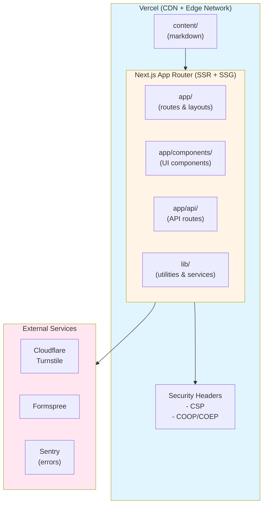
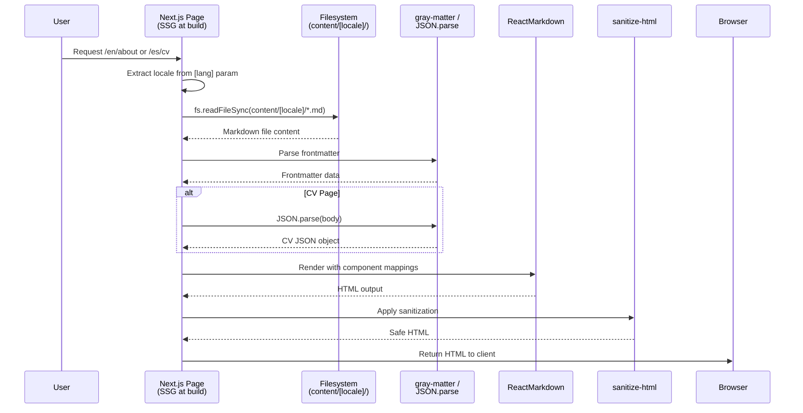
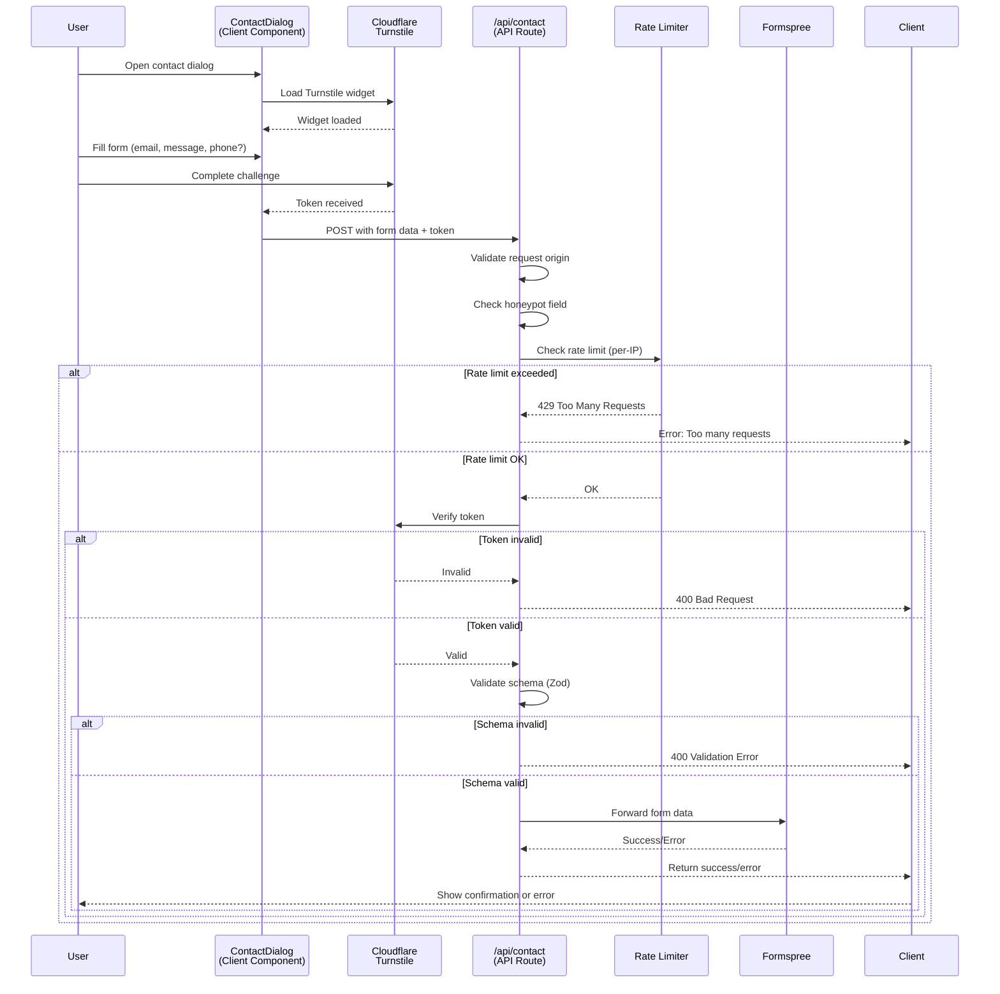
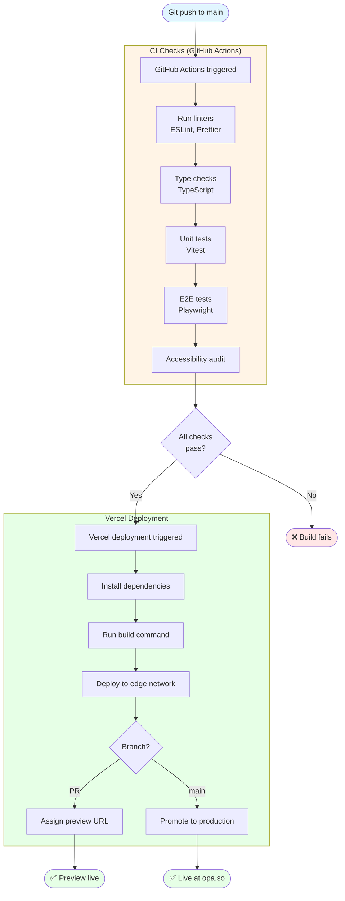

# Architecture Overview

This document describes the technical architecture of the `vicenteopaso-vibecode` site, including system components, key flows, and deployment model.

## Goals

> Governance: `docs/CONSTITUTION.md` is the highest-precedence governance document.
> Within its constraints, the machine-readable System Design & Development
> Specification (SDD) for this repository lives in `../sdd.yaml`. This document
> provides the narrative architecture overview that complements the SDD.

- Future-proof, SEO-first personal site
- Minimal client-side JavaScript
- Accessible by default (WCAG-aware)
- Easy to extend with new content and sections

## Solution-Agnostic Guidance

- This document describes the current implementation. The authoritative, solution-agnostic specification is `../sdd.yaml`.
- Architecture principles (composition, separation of concerns, a11y/SEO/perf/security baselines) apply regardless of the chosen framework or libraries.
- Changes that impact system boundaries, critical flows, or cross-cutting concerns must update `sdd.yaml` and the relevant documentation.
- **Significant architectural decisions** should be captured as Architecture Decision Records (ADRs) in `docs/adr/`. See [ADR README](./adr/README.md) for guidance.

## Stack

- **Runtime**: Node.js (LTS)
- **Framework**: Next.js 16 (App Router, RSC)
- **Content**: Markdown + JSON CV, read directly from the filesystem at build time (`fs` + `gray-matter`) and validated against a Zod schema in `lib/content.ts`
- **Styling**: Tailwind CSS v4 + Radix UI primitives
- **Deployment**: Vercel
- **Testing**: Unit (Vitest) + E2E (Playwright)
- **Observability**: Vercel Analytics/Speed Insights + Sentry (sampled traces, replay, alerts)

## System Map

### High-Level System Architecture



**ASCII representation (for terminals without Mermaid support):**

```
┌─────────────────────────────────────────────────────────────┐
│                   Vercel (CDN + Edge Network)                │
│  ┌───────────────────────────────────────────────────────┐  │
│  │  Next.js App Router (SSR + SSG)                       │  │
│  │  ├─ app/                  (routes & layouts)          │  │
│  │  ├─ app/components/       (UI components)             │  │
│  │  ├─ app/api/              (API routes)                │  │
│  │  └─ lib/                  (utilities & services)      │  │
│  └───────────────────────────────────────────────────────┘  │
│           ▲                        │                         │
│           │                        ▼                         │
│  ┌────────────────┐      ┌──────────────────┐               │
│  │  content/      │      │  Security Headers │               │
│  │  (markdown)    │      │  - CSP            │               │
│  │                │      │  - COOP/COEP      │               │
│  └────────────────┘      └──────────────────┘               │
└─────────────────────────────────────────────────────────────┘
         │                           │
         │                           └──────────────┐
         │                                          ▼
         │                              ┌────────────────────────┐
         │                              │  External Services     │
         │                              │  ├─ Cloudflare         │
         │                              │  │   Turnstile         │
         │                              │  ├─ Formspree          │
         │                              │  └─ Sentry (errors)    │
         │                              └────────────────────────┘
```

## High-Level Design

- `app/` — Route segments and layout composition using the App Router
- `content/` — Markdown source of truth for pages and CV content
- `lib/` — Shared utilities (SEO, analytics, schema JSON-LD, content loading/validation)
- `components/` — Reusable presentational and layout components
- `styles/` — Global and design token styles
- `scripts/` — Automation scripts (OG generation, link validation, a11y audits)

Rendering is handled primarily via **Server Components**, with Client Components
introduced only where interactivity is required.

## Content Model & Rendering

- Content is organized by locale under `content/[locale]/` (e.g., `content/en/about.md`, `content/es/about.md`)
- `content/[locale]/about.md` contains frontmatter and markdown for the About page
- `content/[locale]/cv.md` contains frontmatter and a JSON object in the markdown body for the CV
- Markdown-backed content pages under `app/[lang]/` (e.g., policies/governance pages and `cv/page.tsx` for CV frontmatter) read locale-specific content files at build time using `fs` + `gray-matter` / `JSON.parse`, via the shared `loadContentPage()` helper in `lib/content.ts`, which validates frontmatter (required `name`/`title`/`slug`) with Zod

**Content Rendering Flow:**



**Text representation:**

```
User requests /en/about or /es/cv
  ↓
Next.js page component (SSG at build time with force-static)
  ↓
Extract locale from [lang] route parameter
  ↓
Read markdown from content/[locale]/ directory (fs.readFileSync)
  ↓
Parse frontmatter with gray-matter
  ↓
For CV: extract and parse JSON object from body
  ↓
Render with ReactMarkdown using shared component mappings from `lib/markdown-components.tsx` (intro/about variants on `/about`, standard `markdownComponents` on policy/governance pages)
  ↓
Apply sanitization (sanitize-html) for rich content
  ↓
Return HTML to client
```

**Key files:**

- `app/[lang]/page.tsx` - renders `content/[locale]/about.md` (About page for each locale)
- `app/[lang]/cv/page.tsx` - renders `content/[locale]/cv.md` with JSON CV parsing
- `lib/sanitize-html.ts` - sanitizes rich content
- `lib/i18n/` - locale detection and UI string translation utilities

**Error handling:**

- CV JSON parsing has graceful fallbacks for invalid JSON
- Missing files handled with appropriate error boundaries
- Logs errors to Sentry in production

## Contact Flow

The contact form implements defense-in-depth with multiple validation layers:

**Contact Form Submission Flow:**



**Text representation:**

```
User opens contact dialog
  ↓
ContactDialog component loads Cloudflare Turnstile
  ↓
User fills form (email, message, optional phone)
  ↓
Turnstile challenge completes → token received
  ↓
Client POSTs to /api/contact
  ↓
API route validates:
  - Request origin (domain check)
  - Honeypot field (spam filter)
  - Rate limiting (per-IP)
  - Turnstile token verification
  - Form data schema (Zod)
  ↓
If valid: forward to Formspree
  ↓
Return success/error to client
  ↓
Client shows confirmation or error message
```

**Key files:**

- `app/components/ContactDialog.tsx` - client component with Turnstile integration
- `app/api/contact/route.ts` - API route handler with validation
- `lib/rate-limit.ts` - in-memory rate limiting (best-effort, per-instance)

**Security measures:**

- Cloudflare Turnstile verification (CAPTCHA alternative)
- Honeypot field to catch simple bots
- Origin/domain validation
- Rate limiting by client IP
- Content Security Policy (CSP) headers

**Data Flow Diagram:**

```mermaid
graph LR
    User([User Browser])
    Dialog[ContactDialog<br/>Component]
    Turnstile[Cloudflare<br/>Turnstile]
    API[/api/contact<br/>Route]
    Verify[Token<br/>Verification]
    Formspree[Formspree<br/>Email API]

    User -->|Opens dialog| Dialog
    Dialog <-->|Challenge/Token| Turnstile
    Dialog -->|POST form data| API
    API -->|Verify token| Verify
    Verify -->|Valid| API
    API -->|Forward email| Formspree
    Formspree -->|Confirmation| API
    API -->|Success/Error| User

    style User fill:#e1f5ff
    style Dialog fill:#fff4e6
    style Turnstile fill:#ffe6f0
    style API fill:#fff4e6
    style Formspree fill:#e6ffe6
```

**Text representation:**

```
┌──────────┐      ┌──────────────┐      ┌─────────────┐
│  User    │─────▶│ ContactDialog│─────▶│ Cloudflare  │
│  Browser │      │  Component   │      │ Turnstile   │
└──────────┘      └──────────────┘      └─────────────┘
     ▲                    │                     │
     │                    ▼                     ▼
     │            ┌──────────────┐      ┌─────────────┐
     │            │  /api/contact│◀─────│   Token     │
     │            │  Route       │      │ Verification│
     │            └──────────────┘      └─────────────┘
     │                    │
     │                    ▼
     │            ┌──────────────┐
     └────────────│  Formspree   │
                  │  Email API   │
                  └──────────────┘
```

## SEO & Metadata

- SEO is centralized in a small `lib/seo` layer (site config, base metadata, and JSON-LD helpers).
- `app/layout.tsx` uses the Next.js Metadata API for titles, descriptions, and Open Graph tags.
- JSON-LD for `WebSite` and `Person` schema is injected via a dedicated component used in the root layout.
- Open Graph images are generated via locale-aware routes (`app/[lang]/opengraph-image.tsx` and `app/[lang]/cv/opengraph-image.tsx`).
  - Images are dynamically generated using Next.js ImageResponse API
  - Support both English (`/en/opengraph-image`) and Spanish (`/es/opengraph-image`) with translated content
  - Each locale receives appropriately translated badge text, subtitles, and metadata

**SEO Implementation:**

- `lib/seo.ts` - single source of truth for site config (name, URL, description)
- `baseMetadata()` - returns Next.js `Metadata` object with defaults
- `getWebsiteJsonLd()` - generates WebSite schema JSON-LD
- `getPersonJsonLd()` - generates Person schema JSON-LD
- `app/components/SeoJsonLd.tsx` - injects JSON-LD scripts

**Structured Data:**

- `WebSite` schema on all routes
- `Person` schema on `/about` and `/cv` only
- See `docs/SEO_GUIDE.md` for full details

## Testing & Coverage

- Unit tests are written with Vitest and run in a jsdom environment.
- Playwright handles end-to-end tests under `test/e2e`, targeting `http://localhost:3000`.
- Visual regression tests under `test/visual` use Playwright with masking utilities for deterministic screenshots.
- Coverage is collected via Vitest with thresholds enforced at **90% lines**, **90% statements**, **90% branches**, and **90% functions**, as configured in `vitest.config.ts` and described in `sdd.yaml`.
- CI runs linting, typechecking, unit tests, coverage, E2E tests, visual tests, accessibility checks, and CodeQL analysis on PRs and pushes to `main`.

**AI Guardrails:**

- Code changes in `app/` or `lib/` must include corresponding test changes (enforced by `scripts/check-pr-tests.mjs` in CI).
- PRs labeled `architecture-change` must link to an ADR in `docs/adr/` (enforced by PR template validation).
- All PRs must complete quality checkboxes: accessibility, SEO, security, error handling.
- See [ADR-0001](./adr/0001-implement-ai-guardrails.md) for rationale and [TESTING.md](./TESTING.md) for details.

**Test Commands:**

```bash
pnpm test              # Run Vitest unit tests
pnpm test:e2e          # Run Playwright E2E tests
pnpm test:visual       # Run Playwright visual regression tests
pnpm coverage          # Run tests with coverage report
```

## Security Architecture

**Security Headers Flow:**

```
All HTTP responses from Vercel
  ↓
next.config.mjs applies security headers
  ↓
Headers attached to response:
  - Content-Security-Policy (CSP)
  - X-Frame-Options (DENY)
  - X-Content-Type-Options (nosniff)
  - Referrer-Policy (no-referrer-when-downgrade)
  - Permissions-Policy (restrictive)
  - Cross-Origin-Opener-Policy (same-origin)
  - Cross-Origin-Resource-Policy (same-origin)
  ↓
Browser enforces policies
```

**Defense in Depth:**

1. **Network Layer**: Vercel edge network with DDoS protection, CDN caching, HTTPS enforcement
2. **Application Layer**: CSP, CORS restrictions, input validation (Zod), output sanitization
3. **API Layer**: Rate limiting, honeypot filter, Turnstile verification, origin checks
4. **Monitoring**: Sentry error tracking, Vercel logs, structured logging

**CSP Configuration** (from `next.config.mjs`):

- Scripts: self, Turnstile, Sentry CDN (lazy-loaded Session Replay), inline Next.js. The WebMCP polyfill is bundled (`lib/webmcp.ts`), not loaded from a third-party CDN.
- Styles: self, inline (Tailwind)
- Images: self, data URIs
- Frames: Turnstile only
- Connect: self, Turnstile, Formspree
- Form actions: self, Formspree

See `docs/SECURITY_POLICY.md` for full security guidelines.

## Observability & Error Handling

**Current approach**: Vercel's observability is complemented by Sentry for aggregation, replay, and alerts.

- **Vercel Analytics**: Page views, user interactions
- **Vercel Speed Insights**: Core Web Vitals, performance metrics
- **Vercel Logs**: Server-side error logs (all `console.error()` output)
- **Production source maps**: Stack traces show original TypeScript line numbers
- **Sentry (Next.js SDK)**: Client/server exception tracking, issue grouping, breadcrumbs, session replay, and alerting

Sentry is configured via `sentry.client.config.ts`, `sentry.server.config.ts`, and `sentry.edge.config.ts`, with structured logging wired through `lib/error-logging.ts` and a `GlobalErrorHandler` client component.

**Why this stack?** For a low-traffic personal portfolio, Vercel's observability provides a solid baseline, while Sentry adds aggregation, replay, and alerting with minimal complexity. Sampling keeps overhead reasonable while still surfacing meaningful issues.

**When to tune**: If traffic exceeds ~10k users/month or error volume grows, revisit Sentry sampling and alert rules rather than adding new tooling.

See **[ERROR_HANDLING.md](./ERROR_HANDLING.md)** for full error handling patterns and debugging workflows.

## Build & Deployment Pipeline

### Local Development

```bash
pnpm dev              # Start dev server (port 3000)
pnpm lint             # Run ESLint
pnpm format           # Run Prettier
pnpm typecheck        # TypeScript compilation check
pnpm test             # Run Vitest unit tests
pnpm test:e2e         # Run Playwright E2E tests
```

### Build Process

```
1. pnpm install            # Install dependencies
2. pnpm build              # Next.js production build
   ├─ Compile TypeScript
   ├─ Generate static pages (SSG)
   ├─ Optimize assets
   ├─ Generate sitemap (next-sitemap)
   └─ Output to .next/
3. pnpm start              # Production server
```

### CI/CD (GitHub Actions → Vercel)



**Text representation:**

```
Git push to main branch
  ↓
GitHub Actions triggered
  ├─ Run linters (ESLint, Prettier)
  ├─ Run type checks (TypeScript)
  ├─ Run unit tests (Vitest)
  ├─ Run E2E tests (Playwright)
  └─ Run accessibility audit
  ↓
If checks pass:
  ↓
Vercel deployment triggered
  ├─ Install dependencies
  ├─ Run build command
  ├─ Deploy to edge network
  ├─ Assign preview URL (for PRs)
  └─ Promote to production (for main branch)
  ↓
Live at opa.so
```

**Environment variables (Vercel):**

- `NEXT_PUBLIC_FORMSPREE_KEY` - Formspree form ID
- `NEXT_PUBLIC_TURNSTILE_SITE_KEY` - Cloudflare Turnstile site key
- `TURNSTILE_SECRET_KEY` - Cloudflare Turnstile secret (server-side)
- `SENTRY_DSN` - Sentry DSN for server/edge runtime
- `NEXT_PUBLIC_SENTRY_DSN` - Sentry DSN for client-side (public)
- `SENTRY_ENVIRONMENT` - Environment label (development/preview/production)
- `SENTRY_AUTH_TOKEN` - Sentry auth token for source map uploads
- `SENTRY_ORG` - Sentry organization slug
- `SENTRY_PROJECT` - Sentry project slug
- `SENTRY_TRACES_SAMPLE_RATE` - Performance sampling rate (optional, defaults to 0.1)

See [`docs/SENTRY_SETUP.md`](./SENTRY_SETUP.md) for detailed Sentry configuration instructions.

## Directory Structure

### Project Organization

```mermaid
graph TD
    Root["/"]

    subgraph App["app/ (Next.js App Router)"]
        Layout["layout.tsx<br/>(Root layout + providers)"]
        Lang["[lang]/<br/>(Locale routes)"]
        LangLayout["[lang]/layout.tsx"]
        LangPage["[lang]/page.tsx<br/>(About page)"]
        CV["[lang]/cv/page.tsx"]
        Policies["[lang]/accessibility/<br/>[lang]/privacy-policy/<br/>etc."]
        APIRoutes["api/contact/route.ts<br/>api/content/[slug]/route.ts"]
        Components["components/<br/>(Shared UI)"]
    end

    subgraph Content["content/ (Markdown + JSON)"]
        EN["en/<br/>(English content)"]
        ES["es/<br/>(Spanish content)"]
        ENAbout["about.md<br/>cv.md<br/>cv.json<br/>policies..."]
        ESAbout["about.md<br/>cv.md<br/>cv.json<br/>policies..."]
    end

    subgraph Lib["lib/ (Utilities)"]
        I18n["i18n/<br/>(Locale detection)"]
        SEO["seo.ts<br/>(Metadata helpers)"]
        ErrorLog["error-logging.ts<br/>(Sentry integration)"]
        RateLimit["rate-limit.ts"]
        Markdown["markdown-components.tsx"]
        Sanitize["sanitize-html.ts"]
    end

    subgraph Test["test/ (Testing)"]
        Unit["unit/<br/>(Vitest)"]
        E2E["e2e/<br/>(Playwright)"]
        Visual["visual/<br/>(Playwright screenshots)"]
    end

    subgraph Docs["docs/ (Governance)"]
        ADR["adr/<br/>(Architecture decisions)"]
        Standards["ENGINEERING_STANDARDS.md<br/>ARCHITECTURE.md<br/>etc."]
    end

    Root --> App
    Root --> Content
    Root --> Lib
    Root --> Test
    Root --> Docs

    App --> Layout
    App --> Lang
    App --> APIRoutes
    App --> Components
    Lang --> LangLayout
    Lang --> LangPage
    Lang --> CV
    Lang --> Policies

    Content --> EN
    Content --> ES
    EN --> ENAbout
    ES --> ESAbout

    Lib --> I18n
    Lib --> SEO
    Lib --> ErrorLog
    Lib --> RateLimit
    Lib --> Markdown
    Lib --> Sanitize

    Test --> Unit
    Test --> E2E
    Test --> Visual

    Docs --> ADR
    Docs --> Standards

    style App fill:#fff4e6
    style Content fill:#e1f5ff
    style Lib fill:#f0f0f0
    style Test fill:#ffe6f0
    style Docs fill:#e6ffe6
```



**Text representation:**

```
app/
├── layout.tsx               # Root layout with providers and Sentry
├── [lang]/                  # Locale-specific routes (en, es)
│   ├── layout.tsx          # Locale layout wrapper
│   ├── page.tsx            # About page (reads content/[locale]/about.md)
│   ├── cv/
│   │   └── page.tsx        # CV page (reads frontmatter from content/[locale]/cv.md and JSON from content/[locale]/cv.json)
│   ├── accessibility/
│   │   └── page.tsx        # Accessibility statement
│   ├── cookie-policy/
│   │   └── page.tsx        # Cookie policy
│   ├── privacy-policy/
│   │   └── page.tsx        # Privacy policy
│   ├── tech-stack/
│   │   └── page.tsx        # Tech stack documentation
│   └── technical-governance/
│       └── page.tsx        # Technical governance documentation
├── api/
│   ├── contact/
│   │   └── route.ts        # Contact form API route
│   └── content/
│       └── [slug]/
│           └── route.ts    # Content API (legacy)
├── components/             # Shared UI components
│   ├── ContactDialog.tsx   # Contact form modal
│   ├── ErrorBoundary.tsx   # React error boundary
│   ├── Header.tsx          # Site header
│   ├── Footer.tsx          # Site footer
│   ├── LanguageToggle.tsx  # Language switcher
│   ├── LocaleProvider.tsx  # Locale context provider
│   └── ...
└── config/
    └── cv.ts               # CV configuration

content/
├── en/                     # English content (source)
│   ├── about.md
│   ├── cv.md                # Frontmatter (name, title, slug, tagline)
│   ├── cv.json              # Structured CV JSON data
│   ├── accessibility.md
│   ├── cookie-policy.md
│   ├── privacy-policy.md
│   ├── tech-stack.md
│   └── technical-governance.md
└── es/                     # Spanish translations (auto-generated)
    └── ...                 # (mirrors en/ structure)

i18n/
├── en/
│   └── ui.json             # English UI strings
└── es/
    └── ui.json             # Spanish UI strings (auto-generated)

lib/
├── i18n/                   # i18n utilities
│   ├── index.ts
│   ├── locales.ts
│   ├── getTranslations.ts
│   └── useTranslations.ts
├── seo.ts                  # SEO utilities & metadata
├── error-logging.ts        # Sentry integration
├── rate-limit.ts           # Rate limiting logic
├── markdown-components.tsx # Shared ReactMarkdown components
└── sanitize-html.ts        # HTML sanitization

styles/
└── globals.css             # Design tokens & global styles

test/
├── unit/                   # Vitest unit tests
└── e2e/                    # Playwright E2E tests
```

## Performance Optimization

- **Static Generation**: About/CV pages statically generated at build time
- **Image Optimization**: Next.js Image component with automatic WebP conversion
- **Code Splitting**: Automatic route-based code splitting
- **Font Optimization**: Self-hosted variable fonts with `font-display: swap`
- **CSS Optimization**: Tailwind CSS purges unused styles
- **Edge Caching**: Static assets cached at CDN edge
- **Lazy Loading**: Components lazy-loaded where appropriate
- **Analytics**: Vercel Speed Insights for Core Web Vitals monitoring

**Core Web Vitals targets:**

- LCP (Largest Contentful Paint): < 2.5s
- FID (First Input Delay): < 100ms
- CLS (Cumulative Layout Shift): < 0.1

## Decision Trees for Common Tasks

### Where should I add a new page?

```
Is the page locale-specific (needs /en/ and /es/ versions)?
  ├─ YES: Add under app/[lang]/[page]/page.tsx + content/[locale]/[page].md
  └─ NO: Check if it's an API/system endpoint, or policy/static page

Is it a policy page (privacy, cookies, accessibility)?
  ├─ YES: Create content/[locale]/[policy-name].md + app/[lang]/[policy-name]/page.tsx
  │       Page reads and renders markdown with ReactMarkdown
  └─ NO: Is it dynamic content from an API or database?
         └─ NO: Probably static content (like /tech-stack/) → use SSG with app/[lang]/[slug]/page.tsx

Is it an API route (not a page)?
  ├─ YES: Create app/api/[route]/route.ts
  │       Include Zod schema validation and error logging
  └─ NO: It's a public page

Does the page need metadata (OG images, title, description)?
  ├─ YES: Export metadata from page.tsx or layout.tsx
  │       For OG images: create app/[lang]/[page]/opengraph-image.tsx
  │       Ensure opengraph-image.tsx accepts params: Promise<{ lang: Locale }> for locale-awareness
  └─ NO: Let default metadata from root layout apply
```

### Where should I add UI logic?

```
Is it a reusable visual component (Button, Card, Modal)?
  ├─ YES: Create app/components/[ComponentName].tsx (accept all config via props)
  │       No business logic, pure UI + event handlers
  └─ NO: Is it specific to one page?
         ├─ YES: Can colocate in app/[lang]/[page]/ directory
         └─ NO: Check if it's a layout component

Is it a pure function (no React, string transformations, data formatting)?
  ├─ YES: Place in lib/[category]/[function-name].ts
  │       Export type definitions and use for props
  └─ NO: Is it data fetching or external service calls?
         ├─ YES: lib/services/[service-name].ts or app/api/ route handler
         └─ NO: Is it state management or a custom hook?
                └─ Create app/hooks/use[HookName].ts or lib/hooks/
```

### When do I need to update sdd.yaml?

```
Did I add a new architecture boundary or system component?
  ├─ YES: Update architecture.boundaries in sdd.yaml + this document (ARCHITECTURE.md)
  └─ NO: Continue

Did I add a new tech choice or dependency with production impact?
  ├─ YES: Document in stack section (version, justification, alternatives considered)
  └─ NO: Continue

Did I change a critical flow (contact, content rendering, auth)?
  ├─ YES: Update critical-flows or contact-flow in sdd.yaml
  └─ NO: Continue

Did I add a requirement that affects testing, linting, or CI/CD?
  ├─ YES: Update expectations.ci or expectations.testing
  └─ NO: You probably don't need to update sdd.yaml
```

### When do I need to add tests?

```
Did I add a new route (page or API)?
  ├─ YES: Add Playwright E2E test under test/e2e/
  │       Test happy path (200), error cases, and locale variants if applicable
  └─ NO: Is it a new component?
         ├─ YES: Add Vitest unit test under test/unit/
         │       Test props, event handlers, accessibility, error states
         └─ NO: Is it a utility function?
                ├─ YES: Add Vitest unit test
                │       Test valid inputs, edge cases, error cases
                └─ NO: Consider if it's internal logic worth testing
```

### How do I handle i18n (localization)?

```
Is the content user-facing text?
  ├─ YES: Never hardcode English; use locale from [lang] route param or LocaleProvider
  │       For UI strings: use getTranslations(locale) from lib/i18n/
  │       For pages: read content/[locale]/ files based on lang param
  │       For metadata: generate per-locale in metadata export or opengraph-image.tsx
  └─ NO: Is it a route or URL?
         ├─ YES: Always use /[lang]/... pattern, never hardcode /en/ or /es/
         └─ NO: Error messages or logging should have English default

Do I have a new metadata route (opengraph image, RSS feed, etc.)?
  ├─ YES: Make it locale-aware by accepting params: Promise<{ lang: Locale }>
  │       Example: app/[lang]/opengraph-image.tsx
  │       Render translated content based on lang param
  └─ NO: You're good
```

## Related Documentation

- **[ADR Directory](./adr/README.md)** — Architecture Decision Records with context and rationale
- **[AI_AGENT_GUIDE.md](./AI_AGENT_GUIDE.md)** — AI agent quick reference (commands, patterns, constraints)
- **[README.md](../README.md)** — Setup instructions and quick start
- **[ACCESSIBILITY.md](./ACCESSIBILITY.md)** — Accessibility strategy
- **[SEO_GUIDE.md](./SEO_GUIDE.md)** — SEO implementation
- **[SECURITY_POLICY.md](./SECURITY_POLICY.md)** — Security headers and defense-in-depth
- **[ERROR_HANDLING.md](./ERROR_HANDLING.md)** — Error handling and observability
- **[CONTRIBUTING.md](../CONTRIBUTING.md)** — Development workflow and standards
